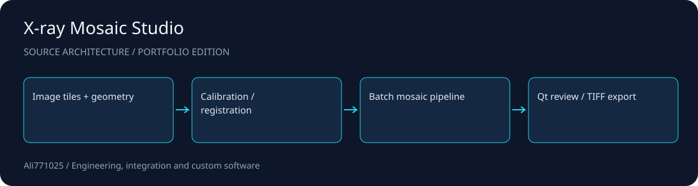

# X-ray Mosaic Studio

**Geometry-aware image mosaics with a Python processing core and Qt review view.**

Imaging software · Scientific Python · Geometric registration

[راهنمای فارسی](docs/README.fa.md) · [Architecture](docs/ARCHITECTURE.md) · [Discuss a project](https://github.com/Ali771025)

## What this demonstrates

- Reference-plane geometry and detector sampling calibration.
- Batch inspection, registration refinement and TIFF export.
- A Qt view for interactive inspection of pipeline results.

## Source map

| Path | Responsibility |
| --- | --- |
| `pyqt_app.py` | Desktop workbench entry point |
| `manual_registration_qt.py` | Manual correspondence interface |
| `visual_mosaic.py` | Visual alignment workflow |
| `xray_mosaic/geometry.py` | Reference-plane geometry |
| `xray_mosaic/registration.py` | Registration refinement |
| `xray_mosaic/pipeline.py` | Batch orchestration |
| `xray_mosaic/qt_view.py` | Review view |

## Setup and integration

Install Python and the packages in `requirements-xray.txt` in an isolated environment. See `python -m xray_mosaic --help` for the inspect, run, calibrate, refine and export entry points. For the desktop workbench, use `python pyqt_app.py`. The core requirements cover its geometric/manual paths; optional scikit-image, PyTorch, Kornia/RoMa and SuperGlue workflows need separate installation and local model preparation. Supply your own licensed image tiles and a geometry batch description matching `xray_mosaic/pipeline.py`; private acquisition data is deliberately absent.

## Scope and evidence

This is an imaging research source edition. Visual alignment does not establish geometric or medical accuracy. No clinical use, numerical accuracy guarantee or current validation result is claimed. The existing PyQt desktop source is included; optional PyTorch/SuperGlue/RoMa/LoFTR implementations and weights must be acquired separately under their own terms. Some optional deep-model integrations may download pretrained weights when enabled; review and pre-provision them for offline use.

This public portfolio edition contains selected source and integration manifests. Contracts, private data, customer materials, original Git history, dependency trees and large assets are excluded. No tests, builds or application runs were performed for this publication; no previous result is presented as a current validation.

## Work with me

I am available for projects involving Imaging software, Scientific Python, Geometric registration. For a useful first discussion, share the problem, target environment, expected deliverables and acceptance criteria. I can help scope an implementation, integration or improvement around your constraints.

Contact: [Ali771025 on GitHub](https://github.com/Ali771025). Please share confidential material through an agreed private channel.

## Rights and dependencies

Publication for portfolio review does not grant a new blanket license. Existing file notices and dependency terms continue to apply. Contact the author to agree terms for reuse or a commercial engagement.
