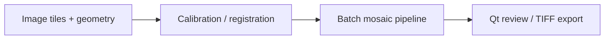

# X-ray Mosaic Studio architecture

The diagram describes the source responsibilities, not a measured production deployment.

| Module | Responsibility |
| --- | --- |
| `xray_mosaic/geometry.py` | Reference-plane geometry |
| `xray_mosaic/registration.py` | Registration refinement |
| `xray_mosaic/pipeline.py` | Batch orchestration |
| `xray_mosaic/qt_view.py` | Review view |

This is an imaging research source edition. Visual alignment does not establish geometric or medical accuracy. No clinical use, numerical accuracy guarantee or current validation result is claimed. Legacy SuperGlue desktop tools are outside this compact edition.
